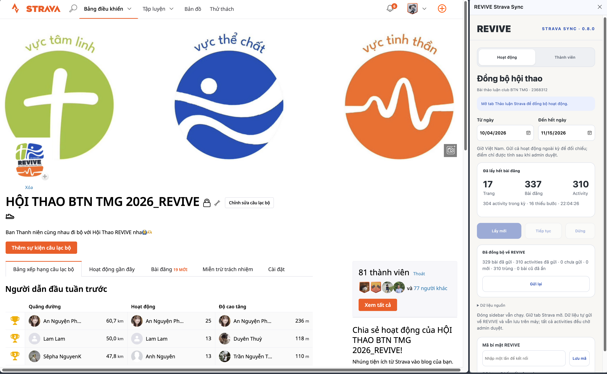
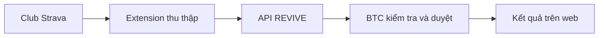

<p align="center">
  
</p>

<h1 align="center">REVIVE Strava Sync</h1>
<p align="center"><strong>Từ bài đăng Strava đến dữ liệu sẵn sàng để BTC đối chiếu.</strong></p>
<p align="center">
  Thu thập hoạt động, bài đăng và thành viên trong club — đồng bộ sang REVIVE ngay từ trình duyệt.
</p>

<p align="center">
  <a href="#cài-đặt"><strong>Cài extension →</strong></a>
  &nbsp;·&nbsp;
  <a href="https://btn-tmg-strava-tracker.vercel.app">Khám phá web app ↗</a>
  &nbsp;·&nbsp;
  <a href="https://github.com/phuc-an-dev/btn-tmg-strava-tracker">Repo web app</a>
</p>

<p align="center">v0.9.0 · Chrome 116+ · Manifest V3 · JavaScript thuần · Không cần build</p>

<p align="center">
  
</p>
<p align="center"><sub>Thu thập và đồng bộ ngay bên cạnh club Strava: theo dõi số trang, bài đăng, activity và kết quả gửi về REVIVE.<br>Ảnh chụp giao diện bản 0.8.0; phiên bản mã nguồn hiện tại là 0.9.0. Số liệu minh họa tại thời điểm chụp.</sub></p>

## Một luồng đồng bộ, hai phần việc rõ ràng



| Thu thập | Đồng bộ | Tiếp tục khi gián đoạn |
| --- | --- | --- |
| Đọc hoạt động, bài đăng, Kudo, ảnh và danh sách thành viên. | Gửi dữ liệu theo lô, giữ nguyên kết quả đã duyệt. | Lưu tiến độ trên máy, tiếp tục lượt quét hoặc gửi lại khi lỗi. |

Extension hỗ trợ BTC Hội thao Ban Thanh Niên Trương Minh Giảng thu thập dữ liệu từ club Strava. Hoạt động mới đồng bộ luôn chờ duyệt; extension không tự cấp điểm thi đấu.

**Tìm nhanh:** [Cách sử dụng](#cách-sử-dụng) · [Quyền truy cập](#quyền-truy-cập-và-bảo-mật) · [Giới hạn](#giới-hạn-cần-biết) · [Tùy biến](#tùy-biến-cho-hệ-thống-riêng) · [Kiểm tra](#phát-triển-và-kiểm-tra)

## Vai trò trong dự án

REVIVE được tạo ra để giảm việc kiểm tra hàng trăm bài đăng Strava và tổng hợp kết quả Hội thao bằng tay. Extension là cầu nối lấy dữ liệu; web app là nơi BTC duyệt, xử lý khiếu nại và hiển thị kết quả.

Thành viên thông thường chỉ cần sử dụng web app. Extension dành cho người vận hành được cấp quyền đồng bộ.

Dự án và tài liệu có sự hỗ trợ của AI trong quá trình phát triển; người phát triển chịu trách nhiệm lựa chọn nghiệp vụ, kiểm tra và điều chỉnh kết quả.

## Chức năng

- Đọc bài thảo luận trong club và nhận diện activity đính kèm, số bước, thông tin đi chung và liên đoàn.
- Đồng bộ hoạt động sang REVIVE theo lô; hoạt động mới luôn ở trạng thái chờ duyệt.
- Nhận diện bài cần bổ sung khi chưa có activity đính kèm, đồng bộ Kudo và ảnh được hỗ trợ.
- Đồng bộ danh sách thành viên Strava, giữ nguyên phân nhóm, liên kết tài khoản và dữ liệu quản lý của web.
- Lưu tiến độ trên máy, hỗ trợ dừng, tiếp tục, gửi lại khi lỗi và tải JSON gốc để đối chiếu.
- Sau lượt quét đầy đủ và gửi thành công, đối soát các bài cần bổ sung đã biến mất khỏi nguồn; web lưu lịch sử thay vì xóa bản ghi.

Extension không có quyền duyệt hoạt động hoặc tự cấp điểm thi đấu.

## Phạm vi hiện tại

Bản này được cấu hình riêng cho:

- Club Strava: `2368312`.
- Web nhận dữ liệu: `https://btn-tmg-strava-tracker.vercel.app`.
- Khoảng ngày mặc định trong giao diện: **04/10/2026–15/11/2026**, theo giờ Việt Nam.

Clone repo không cấp quyền gửi dữ liệu lên REVIVE. Cần mã bí mật do người quản trị hệ thống cung cấp. Nếu muốn dùng cho club hoặc server khác, hãy xem phần tùy biến bên dưới trước khi chạy.

## Cài đặt

Yêu cầu Chrome **116 trở lên**, tài khoản Strava có quyền truy cập club và mã đồng bộ nếu cần gửi lên web.

1. Clone hoặc tải ZIP repo này; giải nén nếu tải ZIP.
2. Mở `chrome://extensions`.
3. Bật **Developer mode** → **Load unpacked** → chọn thư mục chứa `manifest.json`.
4. Đăng nhập Strava và mở trang **Discussion** hoặc **Members** của club.
5. Nhấn biểu tượng extension để mở side panel.

Edge có thể nạp bản unpacked qua `edge://extensions`; cần kiểm tra khả năng hỗ trợ side panel trên phiên bản đang sử dụng.

Sau mỗi lần cập nhật mã nguồn, reload extension rồi reload tab Strava để thay content runner cũ.

## Cách sử dụng

### 1. Kết nối với REVIVE

Nhập **Mã bí mật REVIVE** trong side panel rồi chọn **Lưu mã**. Mã được lưu trong bộ nhớ cục bộ của extension, không được đưa vào ngữ cảnh trang Strava.

Việc lưu mã có thể gửi dữ liệu đã thu thập trước đó. Chỉ dùng mã và máy chủ mà bạn được phép vận hành.

### 2. Đồng bộ hoạt động

1. Mở [Discussion của club](https://www.strava.com/clubs/2368312/discussion).
2. Chọn **Hoạt động**, kiểm tra khoảng ngày rồi nhấn **Lấy mới**.
3. Giữ tab Strava mở trong lúc chạy. Đóng side panel không dừng tiến trình; đóng, tải lại hoặc chuyển trang trong tab Strava sẽ làm tiến trình dừng.
4. Theo dõi riêng tiến độ thu thập và tiến độ gửi dữ liệu.
5. Nếu bị gián đoạn, mở lại đúng trang và chọn **Tiếp tục**. Nếu lỗi gửi, xử lý nguyên nhân rồi chọn **Gửi lại**.

Tiếp tục yêu cầu cùng tài khoản Strava. Một lượt **Lấy mới** thay thế dữ liệu thu thập cục bộ sau khi xác nhận; nếu cần lưu bản cũ, hãy tải JSON gốc trước.

Ngày trong giao diện phục vụ phân loại hoạt động; quá trình đọc vẫn đi qua nguồn bài đăng, không dừng chỉ vì gặp bài cũ. Hoạt động ngoài kỳ cũng có thể được gửi để web đối chiếu, nhưng không vì thế được tính điểm.

### 3. Đồng bộ thành viên

1. Mở [Members của club](https://www.strava.com/clubs/2368312/members).
2. Chọn **Thành viên** → **Đồng bộ thành viên**.
3. Giữ tab mở đến khi đọc và gửi xong.

Extension đọc các trang danh sách và loại trùng theo athlete ID. Nếu tổng Strava công bố không khớp số đã lấy, extension từ chối gửi danh sách đó.

Web chỉ cập nhật dữ liệu nguồn Strava; giữ nguyên tên BTN, nhóm nhỏ, liên đoàn, tài khoản liên kết và trạng thái hoạt động. Thành viên vắng khỏi nguồn không tự động bị xóa.

### 4. Đối chiếu dữ liệu

Mở **Dữ liệu nguồn** → **Tải JSON gốc để đối chiếu**. Tệp này có thể chứa thông tin thành viên và bài đăng; chỉ dùng trong phạm vi được phép, không đính kèm công khai vào issue.

Dữ liệu tiến độ lưu bằng `chrome.storage.local`, không đồng bộ qua tài khoản Chrome. Gỡ extension sẽ xóa dữ liệu cục bộ.

## Nguyên tắc xử lý dữ liệu

- Số bước được nhận diện qua nhãn **Steps / Số bước**, không suy ra từ vị trí cố định hoặc tiêu đề bài đăng.
- Số bước thiếu hoặc activity có thống kê không rõ ràng cần được kiểm tra; không tự coi là dữ liệu đã duyệt.
- Điểm đề xuất: đi một mình bằng số bước; từ 2 người dùng `round(số bước × (1 + số người / 10))`, bao gồm người tạo hoạt động. Kết quả chính thức do web kiểm tra và BTC duyệt.
- Đồng bộ lại activity trùng có thể cập nhật ảnh, không ghi đè số bước đã duyệt, trạng thái, điểm hoặc phân bổ kết quả.
- Kudo thuộc tác giả bài đăng, được theo dõi riêng và không làm thay đổi điểm đi bộ.
- Lượt quét thiếu hoặc thất bại không được dùng để ẩn bài cần bổ sung. Đối soát nguồn chỉ hoàn tất khi lượt quét đầy đủ và các phần gửi liên quan thành công.

## Quyền truy cập và bảo mật

| Quyền | Mục đích |
| --- | --- |
| `activeTab`, `scripting` | Thực thi phần đọc dữ liệu trong tab Strava được phép |
| `storage`, `unlimitedStorage` | Lưu tiến độ, dữ liệu nguồn và cấu hình cục bộ |
| `sidePanel` | Hiển thị bảng điều khiển bên cạnh trình duyệt |
| Host Strava club | Truy cập trang club đã cấu hình |
| Host REVIVE | Gửi dữ liệu sang web app |

Extension dùng phiên đăng nhập Strava hiện tại, không yêu cầu nhập mật khẩu Strava và không trích xuất cookie qua Chrome Cookies API. Yêu cầu đọc nguồn chạy trong ngữ cảnh trang Strava; phần gửi REVIVE chạy trong extension worker và dùng mã đồng bộ riêng.

Không commit mã đồng bộ, dữ liệu xuất hoặc thông tin đăng nhập. Khi cần đổi mã, phải cập nhật cấu hình server, hash trong database và mã đã lưu ở extension cho đồng bộ.

## Giới hạn cần biết

Nguồn đọc là endpoint web không có hợp đồng API công khai mà dự án dựa vào. Thay đổi giao diện, cấu trúc phản hồi hoặc giới hạn truy cập của Strava có thể làm extension ngừng hoạt động.

- Mỗi lần chỉ đọc một request, cách nhau khoảng một giây; lỗi HTTP, timeout hoặc cursor bất thường sẽ dừng và giữ checkpoint.
- Không tự lặp lại liên tục khi gặp lỗi đăng nhập hoặc giới hạn 429.
- Phân trang dựa trên timestamp không bảo đảm tuyệt đối đầy đủ ở ranh giới nhiều bài cùng timestamp. Cần đối chiếu nguồn khi kết quả có nghi vấn.
- Giá trị ngày giờ activity không kèm timezone được xử lý theo giả định giờ Việt Nam.
- Ảnh được gửi dưới dạng URL nguồn; không có bảo đảm URL tồn tại lâu dài. Video không được nhập.

Chỉ sử dụng với dữ liệu bạn được phép truy cập và tuân thủ điều khoản áp dụng của Strava. Đây là công cụ cộng đồng, không phải extension chính thức của Strava.

## Tùy biến cho hệ thống riêng

Bản hiện tại chưa có phần cài đặt club/server trong giao diện. Khi fork, cần rà soát đồng bộ:

1. Club ID, URL, bộ kiểm tra tab và request nguồn trong `core.js`, `background.js`, `delivery.js` và giao diện side panel.
2. Endpoint nhận dữ liệu trong `background.js`, `delivery.js` và `host_permissions` trong `manifest.json`.
3. Khoảng ngày mặc định trong `sidepanel.html`, `sidepanel.js` và quy định thời gian ở web/database.
4. Cấu hình API phía web, mã đồng bộ server và SHA-256 của cùng mã trong database. Xem [README web app](https://github.com/phuc-an-dev/btn-tmg-strava-tracker#ch%E1%BA%A1y-%E1%BB%9F-m%C3%A1y-c%C3%A1-nh%C3%A2n).

Không dùng endpoint REVIVE đang vận hành để thử dữ liệu cho bản fork.

## Phát triển và kiểm tra

Không cần npm install hoặc build để nạp extension. Cần Node.js có hỗ trợ `node --test` để chạy kiểm tra; nên dùng Node LTS hiện hành.

```bash
npm test
npm run check
```

Các bài kiểm tra bao gồm phân tích số bước, loại trùng, khoảng ngày, tính điểm đề xuất, phân trang, lưu/tiếp tục tiến độ và gửi dữ liệu. Chúng không thay thế việc kiểm tra trong Chrome và đối chiếu với nguồn Strava thực tế.

| Tệp | Vai trò |
| --- | --- |
| `manifest.json` | Phiên bản, quyền và cấu hình extension |
| `background.js` | Service worker, đọc dữ liệu và đồng bộ thành viên |
| `content.js` | Điều phối tiến trình trong tab |
| `core.js` | Chuẩn hóa dữ liệu và tiện ích |
| `delivery.js` | Gửi hoạt động, bài đăng và hoàn tất lượt quét |
| `sidepanel.*` | Giao diện điều khiển |
| `tests/` | Kiểm tra bằng Node.js |

## Góp ý

Bạn có thể [mở issue](https://github.com/phuc-an-dev/btn-tmg-strava-crawler-extension/issues) kèm phiên bản trình duyệt, phiên bản trong `manifest.json`, thao tác tái hiện và lỗi đã che thông tin nhạy cảm. Không gửi mã bí mật hoặc toàn bộ JSON chứa dữ liệu thành viên.
